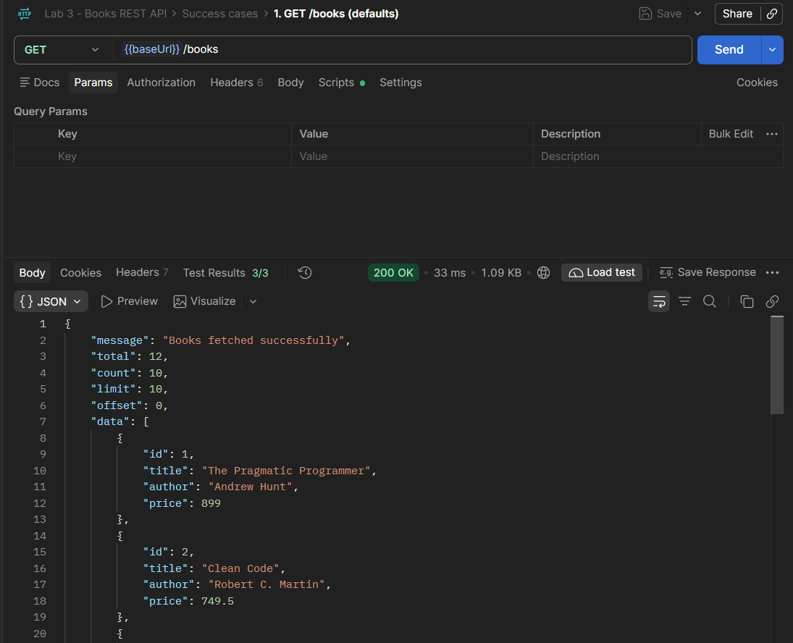
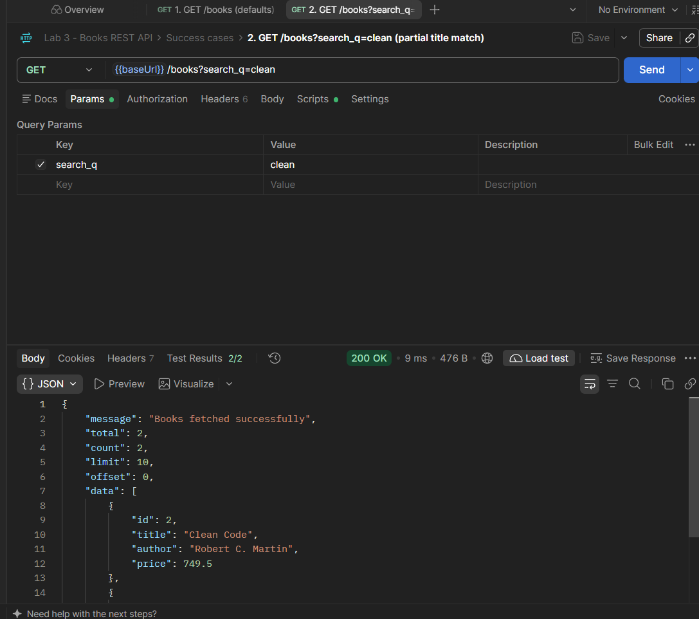
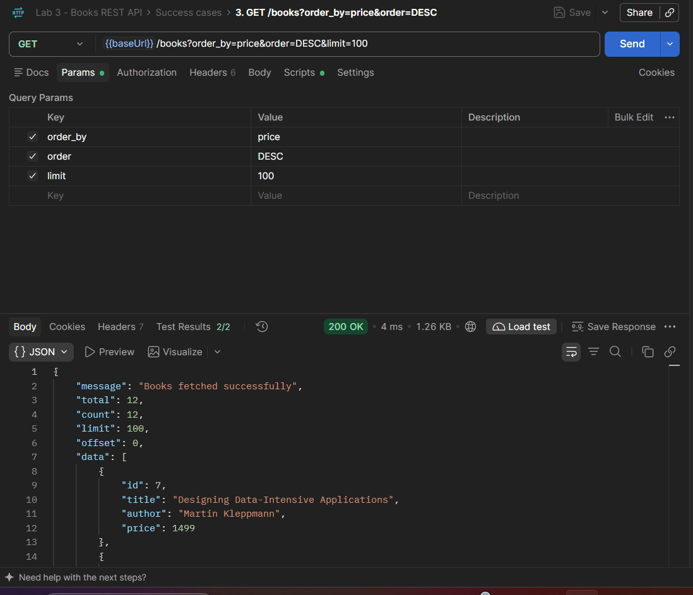
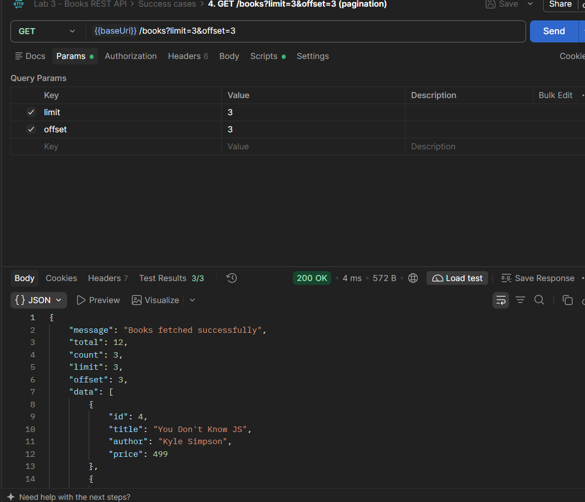
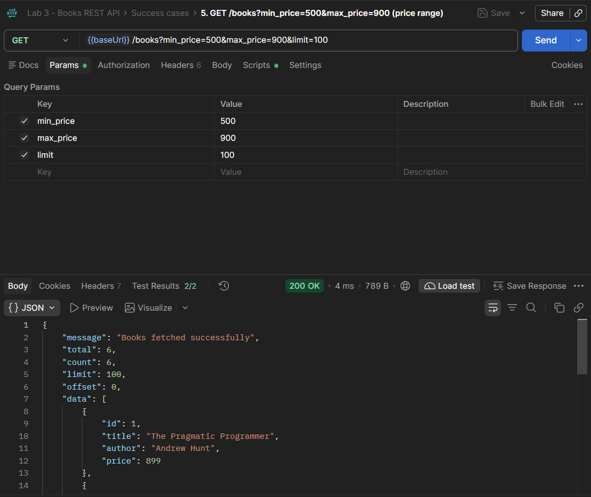
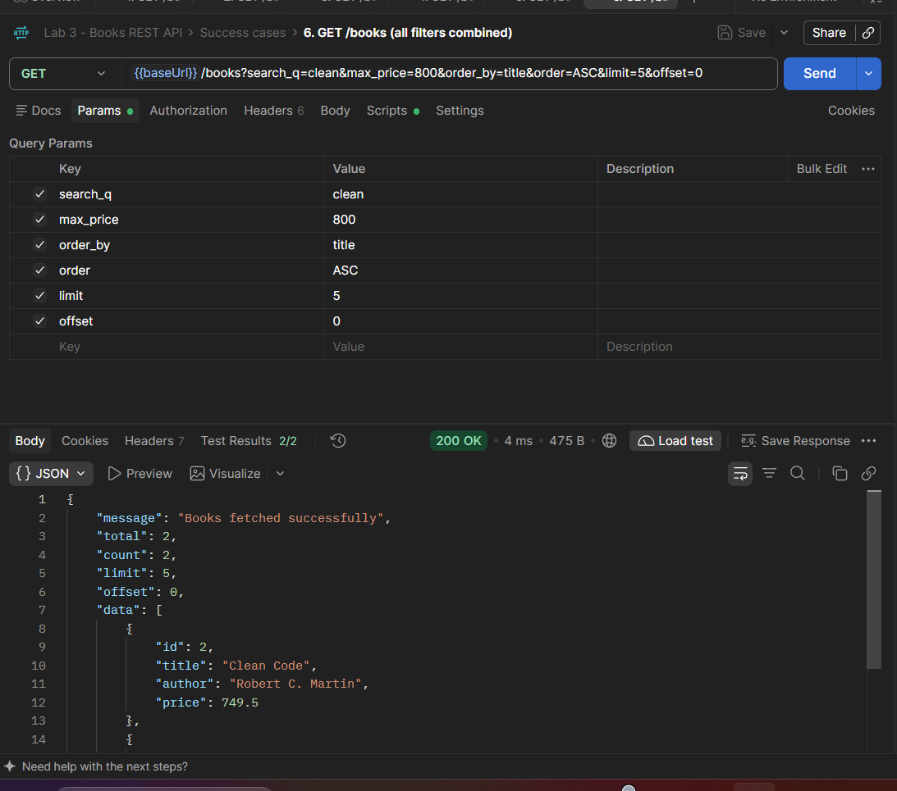

# Lab 3: REST API, query parameters, validation, debugging

**Name:** YOUR NAME · **Registration number:** YOUR REG NO · **Section:** YOUR SECTION

**Live link:** https://YOUR-APP-NAME.onrender.com  *(replace after deploying, see "Deploy" below)*

Backend Development Fundamentals · Year II Term II · Faculty: Joel Prashanth D

A REST API for books built with Node.js, Express and SQLite. It supports search, sorting, price filtering, pagination, input validation and correct HTTP status codes. Every response is JSON, and every error uses the same `{ "message": "..." }` shape.

## How to run

Requires Node.js 20.17 or newer.

```bash
cd lab-03
npm install
cp .env.example .env      # then edit values if needed (Windows: copy .env.example .env)
npm start
```

The server starts on `http://localhost:3000`. The SQLite database file and the `books` table are created automatically on first run and filled with 12 sample books.

### Environment variables

| Variable  | Default     | Purpose                                      |
|-----------|-------------|----------------------------------------------|
| `PORT`    | `3000`      | Port the server listens on                   |
| `DB_PATH` | `./books.db`| Location of the SQLite database file         |

No secrets are needed for this lab. `.env` is git-ignored; only `.env.example` is committed.

### Run the automated tests

```bash
npm test
```

This runs 39 checks (success and failure cases) against an in-memory database.

## Endpoints

| Method | Path          | Description                                              | Success | Errors        |
|--------|---------------|----------------------------------------------------------|---------|---------------|
| GET    | `/`           | Welcome message listing the endpoints                    | 200     |               |
| GET    | `/health`     | Health check                                             | 200     |               |
| GET    | `/books`      | List books with search, sort, filter and pagination      | 200     | 400           |
| GET    | `/books/:id`  | Get one book                                             | 200     | 400, 404      |
| POST   | `/books`      | Create a book (`title`, `author`, `price`)               | 201     | 400           |
| PUT    | `/books/:id`  | Update a book (`title`, `author`, `price`)               | 200     | 400, 404      |
| DELETE | `/books/:id`  | Delete a book                                            | 200     | 400, 404      |

### Query parameters for `GET /books`

| Parameter    | Default | Rules                                                            |
|--------------|---------|------------------------------------------------------------------|
| `search_q`   | none    | Partial, case-insensitive match on title (`LIKE %q%`)            |
| `order_by`   | `id`    | One of `id`, `title`, `author`, `price`                          |
| `order`      | `ASC`   | `ASC` or `DESC`                                                  |
| `limit`      | `10`    | Whole number, 1 to 100                                           |
| `offset`     | `0`     | Whole number, 0 or more                                          |
| `min_price`  | none    | Number. Used with `max_price` it becomes `price BETWEEN ? AND ?` |
| `max_price`  | none    | Number. `min_price` must not be greater than `max_price`         |

Example:

```
GET /books?search_q=clean&min_price=500&max_price=900&order_by=price&order=DESC&limit=5&offset=0
```

### Response format

Success (list):

```json
{
  "message": "Books fetched successfully",
  "total": 2,
  "count": 2,
  "limit": 10,
  "offset": 0,
  "data": [{ "id": 2, "title": "Clean Code", "author": "Robert C. Martin", "price": 749.5 }]
}
```

Success (single, create, update): `{ "message": "...", "data": { ... } }`. Delete: `{ "message": "Book deleted successfully" }`.

Error: `{ "message": "..." }`. Validation errors also include an `errors` array listing every problem found.

```json
{
  "message": "title is required and must be a non-empty string; price is required and must be a number",
  "errors": ["title is required and must be a non-empty string", "price is required and must be a number"]
}
```

### Status codes used

| Code | When                                                                       |
|------|----------------------------------------------------------------------------|
| 200  | Successful read, update or delete                                          |
| 201  | Book created                                                               |
| 400  | Bad input: missing or invalid body fields, bad query parameters, bad id, malformed JSON |
| 404  | The id does not exist, or the route does not exist                         |
| 500  | Unexpected server error                                                    |

## Project structure

```
lab-03/
├── src/
│   ├── server.js        # starts the server (handles EADDRINUSE, graceful shutdown)
│   ├── app.js           # Express app, JSON parsing, 404 and error handlers
│   ├── db.js            # opens SQLite, creates the table, seeds sample data
│   ├── validate.js      # body and query-parameter validation
│   └── routes/books.js  # the /books routes
├── test/api.test.js     # 39 automated checks
├── postman/             # importable Postman collection (22 requests)
├── POSTMAN_TESTS.md     # Postman test list (success and failure)
├── DEBUGGING.md         # debugging exercise notes
├── render.yaml          # Render deployment config
├── .env.example
└── .gitignore
```

## Deploy

Render (free plan) is the quickest option:

1. Push your repository to GitHub (the `lab-03/` folder must be inside it).
2. On [render.com](https://render.com), choose **New + > Web Service** and select your repository.
3. Set **Root Directory** to `lab-03`, **Build Command** to `npm install` and **Start Command** to `npm start`. (Or use **New + > Blueprint**, which reads `render.yaml`.)
4. Add the environment variable `DB_PATH` = `./books.db`. Render sets `PORT` for you.
5. When the deploy finishes, copy the public URL to the top of this README and test `https://YOUR-APP-NAME.onrender.com/health`.

Note: on Render's free plan the disk is temporary, so the SQLite file resets whenever the service restarts or redeploys. The sample books are inserted again automatically, so the API keeps working, but books you add through POST will not survive a restart. The free plan also sleeps after inactivity, so the first request can take around a minute.

Railway and the NxtWave Cloud IDE work the same way: install with `npm install`, start with `npm start`, and let the platform provide `PORT`.

## Screenshots

Add your own screenshots to the `screenshots/` folder and show them here. Suggested set:

```








```

Replace the block above with the real image links once the files exist.

## Notes: problems faced and how I solved them

Fill this section in your own words after doing the debugging exercise. `DEBUGGING.md` has the four classic errors, how to recognise them, and the fixes.

| Problem | Cause | Fix |
|---------|-------|-----|
| `EADDRINUSE` | Another process already used the port | Stop the old process or change `PORT` |
| `Cannot find module` | Wrong import path | Correct the relative path |
| `SQLITE_ERROR: no such table` | Typo in the table name | Match the name used in `CREATE TABLE` |
| Empty `{}` returned instead of rows | Missing `await` | Add `await` before the database call |
