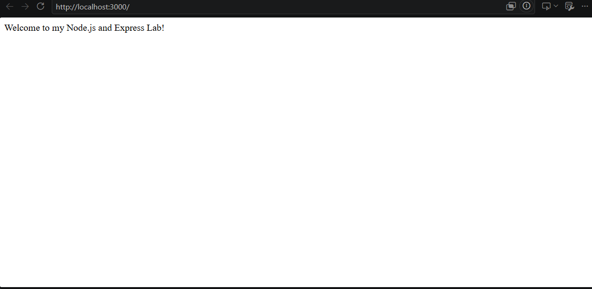
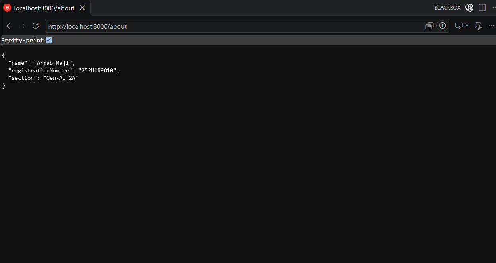
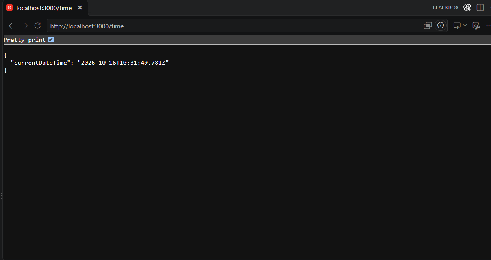
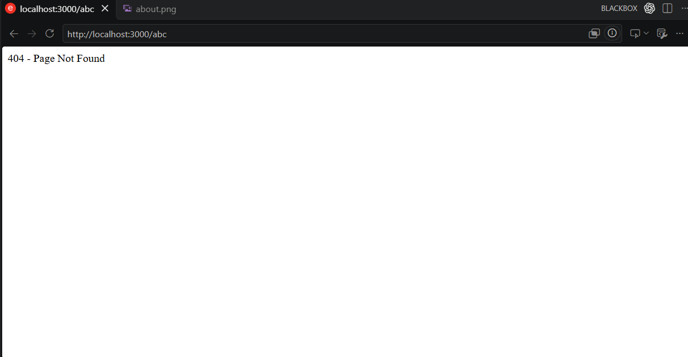

# Lab 1: Node.js and Express server

**Course:** Backend Development Fundamentals · Year II Term II · Aurora  
**Faculty:** Joel Prashanth D  

- **Name:** Arnab Maji  
- **Registration Number:** 252U1R9010  
- **Section:** Gen-AI 2A  

---

## Live Link

- **Live URL:** [https://lab-01-express-arnab.onrender.com](https://lab-01-express-arnab.onrender.com) *(or your deployed Render/Railway service URL)*
- **Local URL:** `http://localhost:3000`

---

## Objective

Set up a Node.js project and build a modular web server, first using Node's built-in `http` module (`plain-server.js`) and then rewriting and extending it using `Express.js` (`server.js`) with dedicated routes and error handling.

---

## How to Run

### 1. Prerequisites
- [Node.js](https://nodejs.org/) (v18.x or later recommended)
- `npm` (Node Package Manager)

### 2. Environment Variables
Create an optional `.env` file in the `lab-01/` directory if configuring custom environment variables:
```env
PORT=3000
```
*(Note: As per lab rules, `.env` is excluded in `.gitignore` and never committed).*

### 3. Install Dependencies
Navigate to the `lab-01` folder and install the project dependencies:
```bash
npm install
```

### 4. Running the Servers

#### A. Plain HTTP Server (`plain-server.js`)
To run the server built with the native Node.js `http` module:
```bash
npm run plain
# or: node plain-server.js
```
- Available at: `http://localhost:3000/`
- Output: Plain text `"Hello"` (Status 200)

#### B. Express Server (`server.js`)
To run the full Express server with route handling:
```bash
npm start
# or: node server.js
```
- Server starts on: `http://localhost:3000` (or `process.env.PORT`)

---

## Explanation of `package.json` Fields (Task 1)

| Field | Description |
|---|---|
| `name` | Unique identifier / name of the project or package (e.g., `"lab-01"`). |
| `version` | Current release version following Semantic Versioning (`MAJOR.MINOR.PATCH`, e.g., `"1.0.0"`). |
| `description` | A short summary explaining the purpose of the project. |
| `main` | Primary entry point of the package/application (e.g., `"server.js"`). |
| `scripts` | Key-value dictionary of custom CLI commands (e.g., `"start": "node server.js"`, `"plain": "node plain-server.js"`). |
| `keywords` | Array of searchable tags/keywords that describe the package. |
| `author` | Person or organization that created and maintains the project (`"Arnab Maji"`). |
| `license` | Legal terms under which the code is distributed (e.g., `"ISC"` or `"MIT"`). |
| `type` | Module system used; `"commonjs"` allows `require()` / `module.exports`. |
| `dependencies` | External packages and versions required for production runtime (e.g., `"express": "^5.3.0"`). |

---

## Endpoints Table

| Method | Path | Description | Expected Status Code | Sample Response |
|:---:|:---:|---|:---:|---|
| **GET** | `/` | Welcome text route | `200 OK` | `Welcome to my Node.js and Express Lab!` |
| **GET** | `/about` | JSON response containing developer details | `200 OK` | `{"name":"Arnab Maji","registrationNumber":"252U1R9010","section":"Gen-AI 2A"}` |
| **GET** | `/time` | Current server date and time using `new Date()` | `200 OK` | `{"currentDateTime":"2026-10-30T05:45:40.067Z"}` |
| **ALL** | `*` (any unknown path) | Catch-all 404 handler for invalid routes | `404 Not Found` | `404 - Page Not Found` |

---

## Screenshots

### 1. Home Route (`GET /`)


### 2. About Route (`GET /about`)


### 3. Time Route (`GET /time`)


### 4. 404 Route (`GET /abc` - Unknown Path)


---

## Notes: Problems Faced and How They Were Solved

1. **Port Hardcoding vs Cloud Deployment:**
   - *Problem:* Hardcoding `PORT = 3000` causes deployment failure on platforms like Render or Railway, which dynamically assign port numbers via environment variables.
   - *Solution:* Used `const PORT = process.env.PORT || 3000;` so the application runs locally on `3000` while automatically respecting cloud-injected ports.
2. **Order of the 404 Handler:**
   - *Problem:* Placing the catch-all middleware (`app.use(...)`) before route declarations would intercept valid routes and return 404 prematurely.
   - *Solution:* Placed the 404 middleware handler as the final routing statement, right before `app.listen()`, ensuring all defined endpoints take precedence.
3. **Explicit HTTP Status Codes:**
   - *Problem:* While Express defaults to `200` for standard responses, production best practice requires explicit status assertions.
   - *Solution:* Explicitly chained `.status(200)` and `.status(404)` to all responses for transparency and conformance with testing specifications.

---

## Viva Questions & Answers

### Q1: What is the difference between `package.json` and `node_modules`?
- **`package.json`:** A lightweight manifest file tracked in Git that defines project metadata, scripts, and a list of dependencies with their allowed version ranges.
- **`node_modules`:** A physical directory containing the actual downloaded code of all dependencies and transitive sub-dependencies. It is large, machine-dependent, excluded from Git via `.gitignore`, and regenerated on demand using `npm install`.

### Q2: What does `app.listen()` do?
- In Express, `app.listen(port, callback)` binds and listens for incoming HTTP connections on the specified port. Under the hood, it creates a Node.js `http.Server` instance using `http.createServer(app)` and begins listening for network socket requests.

### Q3: What do `request` and `response` represent?
- **`request` (`req`):** An object containing all data incoming from the client (HTTP headers, URL query parameters, URL path parameters, request body, client IP, etc.).
- **`response` (`res`):** An object providing methods to construct and send the HTTP response back to the client (setting status codes with `res.status()`, response headers, sending text with `res.send()`, or formatted JSON with `res.json()`).

---

## Deployment Guide (Render / Railway)

1. Push your repository to GitHub (ensure `lab-01` contains `package.json` and `server.js`).
2. Log into [Render](https://render.com) or [Railway](https://railway.app).
3. Create a **New Web Service** and connect your GitHub repository.
4. Set the **Root Directory** to `lab-01` (or root if repository root is dedicated to the lab).
5. Set:
   - **Build Command:** `npm install`
   - **Start Command:** `npm start`
6. Click **Deploy**. Once active, copy the live URL and paste it in the Live Link section above.
